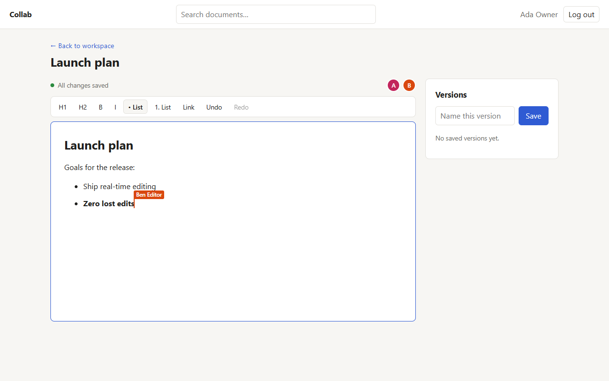
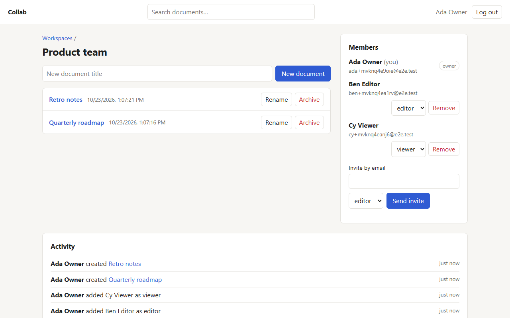
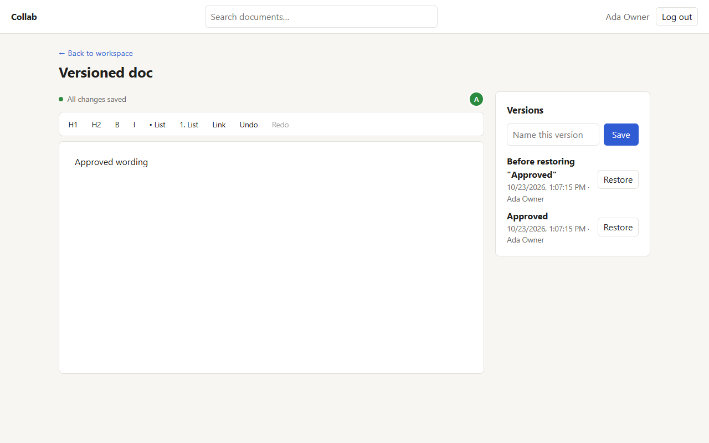
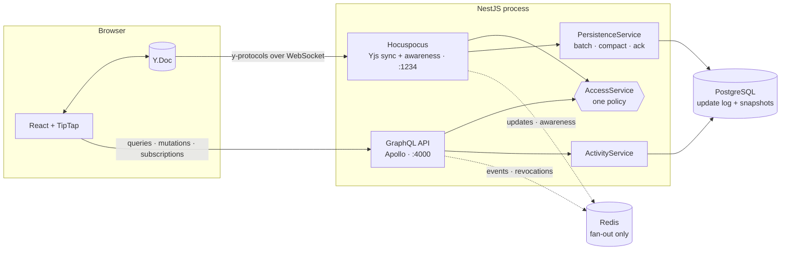
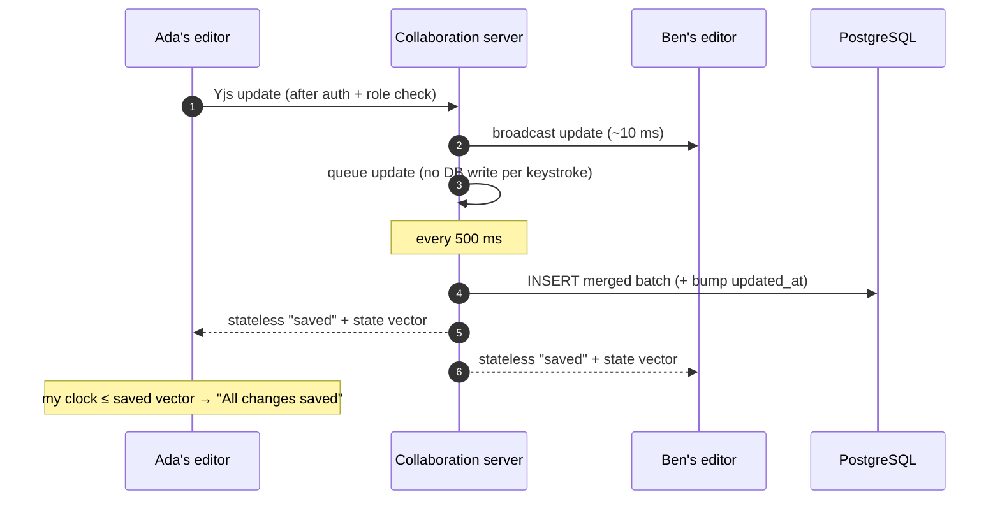

<div align="center">

# ✍️ Collab

**Real-time collaborative documents that never lose an edit.**

Write together with live cursors and presence. Every keystroke is merged conflict-free by Yjs,
acknowledged once it's durable in PostgreSQL, and survives disconnects, restarts and crashes.

[](https://github.com/Madhumitha1621/collab-platform/actions/workflows/ci.yml)


[Features](#-features) · [Quick start](#-quick-start) · [Architecture](#-architecture) · [Performance](#-performance) · [Testing](#-testing) · [Docs](#-documentation)



</div>

## ✨ Features

| | |
|---|---|
| ⚡ **Live co-editing** | Several people edit the same paragraph at once. Yjs CRDTs merge everything, with no locks and no "someone else is editing" |
| 👀 **Cursors & presence** | Named, colored carets and selections, plus avatars of everyone in the document |
| 💾 **Honest "Saved"** | "All changes saved" only appears once the server confirms *your* edits are in PostgreSQL, using state-vector acknowledgements |
| 🔌 **Offline-tolerant** | Drop the connection, keep typing, reconnect: changes sync both ways and converge |
| 🛡️ **Server-enforced roles** | Owner, editor and viewer roles. Viewer writes are rejected **by the server**, even from a hand-crafted client |
| ✂️ **Instant revocation** | Remove or downgrade a member, log out, or archive a document, and their open sessions are cut or downgraded immediately, on every instance |
| 🕰️ **Named versions** | Save a version and restore it later. The restore is a live edit, and it saves "before restoring" first, so it can be undone |
| ✉️ **Email invitations** | Single-use, expiring, hashed-token invites. Existing users get a notification when they're added |
| 🔎 **Search** | Find documents by title across all your workspaces, as you type, with prefix matches first |
| 📜 **Activity history** | Who created, renamed or archived what, who joined, who restored a version. Durable and live |
| 📈 **Scales out** | Add Redis and run N instances: edits, presence, subscriptions and revocations cross instances |
| 🩺 **Operable** | `/health`, Prometheus `/metrics`, structured logs, Docker images, backup and recovery runbook |

<table>
<tr>
<td></td>
<td></td>
</tr>
<tr>
<td align="center"><sub>Workspace: documents, members, invitations, live activity</sub></td>
<td align="center"><sub>Named versions with one-click restore</sub></td>
</tr>
</table>

## 🚀 Quick start

**You need:** Node 20+ and either Docker or nothing else (an embedded PostgreSQL is included).

```bash
npm install
```

```bash
cp apps/server/.env.example apps/server/.env
```

Start PostgreSQL with Docker, **or** without Docker in its own terminal (`npm run db:local -w apps/server`):

```bash
npm run db:up
```

Start the API and collaboration server (migrations run on boot):

```bash
npm run dev:server
```

In another terminal, start the web app on http://localhost:5173:

```bash
npm run dev:web
```

Create three demo accounts (owner, editor, viewer) and a shared document:

```bash
npm run seed:demo
```

Open the printed link in two browser profiles, sign in as two different people, and type. 🎉

<details>
<summary><b>Run the production stack instead</b> (Docker: nginx + API + PostgreSQL + Redis)</summary>

```bash
cp .env.prod.example .env.prod
```

Set `POSTGRES_PASSWORD` and `JWT_SECRET`, then:

```bash
npm run prod:up
```

Everything is served from http://localhost:8080. nginx routes `/graphql` and `/collab` to the
API, so the browser talks to one origin. See [docs/DEPLOYMENT.md](docs/DEPLOYMENT.md) for TLS,
scaling (`--scale server=2`), monitoring and backups.
</details>

## 🧭 Architecture



**How an edit becomes durable:**



Design choices worth knowing:

- **Hocuspocus, not a custom protocol.** It's the maintained y-protocols server behind TipTap.
  NestJS keeps auth, permissions and persistence through its hooks.
- **PostgreSQL is the only source of truth.** Updates are stored as binary `BYTEA` rows, then
  compacted into verified snapshots. Redis is optional and carries no data.
- **One authorization policy** (`AccessService`) used by GraphQL resolvers, subscriptions and the
  collaboration socket, so the rules can't drift apart.
- **Fail closed.** If loading a document from the database fails, the client is refused rather than
  shown an empty document that could overwrite real content.

Full details: [docs/ARCHITECTURE.md](docs/ARCHITECTURE.md).

## 📊 Performance

Load test against the production build (20 editors on one document, 2 edits/s each, single
instance). Methodology in [docs/PERFORMANCE.md](docs/PERFORMANCE.md).

| Metric | PRD target | Measured |
|---|---|---|
| Edit propagation, p95 | ≤ 250 ms | **28.5 ms** |
| Edit → durable "saved" ack, p95 | ≤ 1 s | **512 ms** |
| Recover a 1 MB document from PostgreSQL | ≤ 3 s | **98 ms** |
| Clients converged | all | **20 / 20** |

At 50 editors × 5 edits/s, p95 propagation was still 156 ms.

```bash
npm run load-test
```

## 🧪 Testing

**44 automated tests** run in CI against real PostgreSQL and Redis, plus real Chrome:

| Suite | What it proves |
|---|---|
| `graphql.spec.ts` | Register/login/logout (token revoked), invalid tokens, validation, workspace isolation, role enforcement |
| `collaboration.spec.ts` | Concurrent same-paragraph edits converge · **viewer writes rejected at protocol level** · save acks · offline edits + reconnect · duplicate/out-of-order delivery · live revocation · **restart recovery** |
| `persistence.spec.ts` | Snapshot + log reconstruction · compaction preserves content · **DB outage keeps edits queued, then recovers** |
| `features.spec.ts` | Activity history · search (escaping, isolation, ranking) · invitations (single-use, wrong-account, revoke, re-invite) · **live version restore** (text and rich-text) · `updated_at` on edit |
| `multi-instance.spec.ts` | Two servers + Redis: cross-instance convergence, presence, revocation, subscriptions |
| `e2e/*.spec.ts` (Playwright) | Two real browsers co-editing with formatting, cursors and presence · viewer read-only UI · save and restore versions · search and live activity |

Server tests need PostgreSQL on `localhost:5433` and Redis on `localhost:6379`
(`npm run db:up && npm run redis:up`, or the embedded DB). Run them with:

```bash
npm test
```

Browser tests use your installed Chrome and start their own servers:

```bash
npm run test:e2e
```

## ✅ PRD coverage

| Requirement | Status | Where |
|---|---|---|
| FR-01 Authentication | ✅ | JWT + revocable server-side sessions · [auth/](apps/server/src/auth) |
| FR-02 Workspace management | ✅ | [workspaces/](apps/server/src/workspaces) |
| FR-03 Document management | ✅ | Create, list, rename, archive, timestamps · [documents/](apps/server/src/documents) |
| FR-04 Collaborative editor | ✅ | TipTap + Yjs, headings, bold, italic, lists, links, collaborative undo · [DocumentPage.tsx](apps/web/src/pages/DocumentPage.tsx) |
| FR-05 Presence & cursors | ✅ | Awareness carets, avatars |
| FR-06 Persistence | ✅ | Batched log, compaction, retries, acks · [persistence.service.ts](apps/server/src/persistence/persistence.service.ts) |
| FR-07 Reconnection & recovery | ✅ | Auto-reconnect, fail-closed loading, restart tests |
| FR-08 Authorization & revocation | ✅ | Server read-only, live revocation · [collaboration.service.ts](apps/server/src/collaboration/collaboration.service.ts) |
| FR-09 Application events | ✅ | GraphQL subscriptions with per-event access checks |
| P1 Invitations & email | ✅ | [invitations/](apps/server/src/invitations), [mail/](apps/server/src/mail) |
| P1 Title search | ✅ | `searchDocuments` + top-bar search |
| P1 Named snapshots & restore | ✅ | [snapshots.resolver.ts](apps/server/src/documents/snapshots.resolver.ts), Versions panel |
| P1 Activity history | ✅ | [activity/](apps/server/src/activity), live feed |
| P1 Redis cross-instance | ✅ | Verified with `--scale server=2` |
| P1 Load testing | ✅ | [load-test.mjs](apps/server/scripts/load-test.mjs) · [results](docs/PERFORMANCE.md) |
| P1 Deployment & monitoring | ✅ | Dockerfiles, prod compose, `/health`, `/metrics`, [runbook](docs/DEPLOYMENT.md) |

## 🗂️ Project structure

```
collab-platform/
├─ apps/
│  ├─ server/                  NestJS API + collaboration server
│  │  ├─ src/
│  │  │  ├─ auth/              register · login · sessions · guards
│  │  │  ├─ workspaces/        workspaces · members · AccessService
│  │  │  ├─ documents/         documents · search · versions
│  │  │  ├─ collaboration/     Hocuspocus hooks · revocation · restore
│  │  │  ├─ persistence/       Yjs update log · snapshots · acks
│  │  │  ├─ invitations/       email invitations
│  │  │  ├─ activity/          history + live events
│  │  │  ├─ mail/  events/  health/  database/
│  │  ├─ test/                 Jest integration suites
│  │  └─ scripts/              local DB · demo seed · load test
│  └─ web/                     React + Vite + TipTap (+ nginx.conf for production)
├─ e2e/                        Playwright browser tests
├─ docs/                       architecture · API · deployment · performance
├─ docker-compose.yml          dev PostgreSQL + Redis
└─ docker-compose.prod.yml     production-style stack
```

## 📚 Documentation

| Doc | |
|---|---|
| [ARCHITECTURE.md](docs/ARCHITECTURE.md) | Provider decision, persistence and acknowledgement guarantees, recovery point, revocation, Redis scale-out, versions, invitations |
| [API.md](docs/API.md) | GraphQL operations, roles, error codes, the collaboration WebSocket contract |
| [DEPLOYMENT.md](docs/DEPLOYMENT.md) | Docker stack, TLS, scaling, monitoring, backup and recovery procedures |
| [PERFORMANCE.md](docs/PERFORMANCE.md) | Load-test method and measured results against the PRD targets |

## ⚙️ Configuration

Every server setting is documented in [`apps/server/.env.example`](apps/server/.env.example). The
most important ones:

| Variable | Default | |
|---|---|---|
| `DATABASE_URL` | — | PostgreSQL connection string |
| `JWT_SECRET` | — | Signing secret (required) |
| `REDIS_URL` | *(empty)* | Set it to run several instances |
| `PERSIST_FLUSH_MS` | 500 | Batch window, which is also the crash-loss window for unacknowledged edits |
| `SNAPSHOT_UPDATE_THRESHOLD` | 200 | Update rows before compaction |
| `COLLAB_MAX_MESSAGE_BYTES` / `COLLAB_MAX_MESSAGES_PER_SECOND` | 1 MB / 200 | Abuse limits per connection |
| `SMTP_URL`, `MAIL_FROM`, `WEB_URL` | *(dev: logged)* | Invitation emails |

Web: `VITE_API_URL` and `VITE_COLLAB_URL` (absolute, or same-origin paths like `/graphql`).

## 🛣️ Roadmap

Deliberately out of scope for this version (PRD §4.3): comments and suggestion mode, file uploads,
whiteboards, audio/video, AI features, mobile apps, visual version comparison, and end-to-end
encryption. Email verification at sign-up is the next security step; invitations already prove
mailbox ownership with their token.
